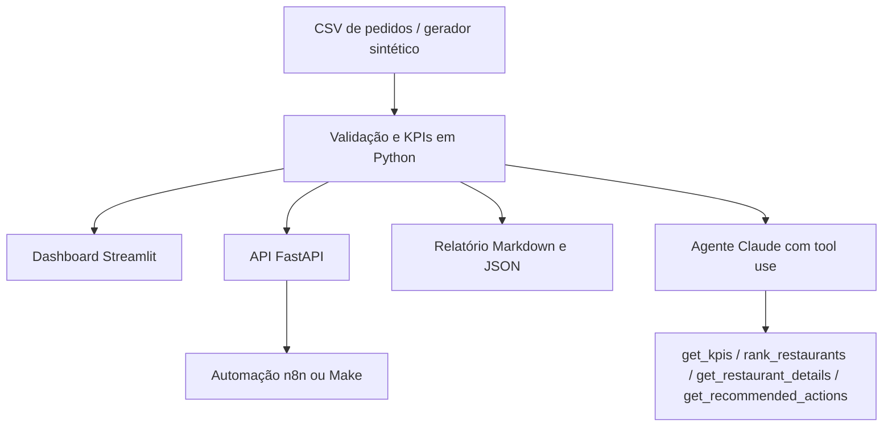

# FoodFlow AI — Operations Copilot

**[Demonstração interativa (GitHub Pages)](https://pedromfr09.github.io/foodflow-ai/)** · [Estudo de caso](docs/CASE_STUDY.md) · [Relatório de exemplo](docs/SAMPLE_REPORT.md)

**Dashboard, agente de IA com ferramentas, API e automação de relatórios para operações de delivery.**

> **Portfolio / independent demo.**  Os dados fornecidos no repositório são **100% sintéticos**. Nenhum ganho operacional ou economia de horas em ambiente real foi medido.

# Problema de negócio

Equipes operacionais precisam detectar atrasos e cancelamentos, identificar restaurantes que merecem atenção e transformar planilhas de pedidos em decisões rastreáveis. Fazer isso manualmente consome tempo e pode dispersar a priorização.

# O que foi construído

| Recurso | Implementação | Situação |
|---|---|---|
| Dashboard de operação | Streamlit + Plotly | Implementado |
| Cálculo de indicadores | Pandas + regras transparentes | Testado |
| Alertas e priorização | Taxas de atrasos/cancelamentos por loja | Testado |
| Relatório exportável | Markdown + JSON | Testado |
| API JSON | FastAPI, validação + Swagger | Testado |
| Robô de relatório | CLI, pronto para agendamento externo | Testado |
| Agente conversacional | Claude API + quatro ferramentas read-only | Implementado; necessita chave API para teste real |
| Fluxo n8n | Exemplo de importação e consulta à API | Modelo fornecido; precisa validar no n8n local |

# Arquitetura



**Guarda-corpos:** sem ações externas por parte do agente, ferramentas somente de leitura, validação dos CSVs, limites por lote, identificadores fictícios, distinção entre observações e hipóteses.

# Visualização instantânea (sem instalar nada)

Abra `index.html` com dois cliques no navegador. É uma **vitrine offline interativa**, com filtros, gráficos, ranking, alertas e exportação JSON. A lógica dessa vitrine é JavaScript local; o app principal, com funcionalidades de Python/Claude, está em `app.py`.

A demonstração está publicada pelo GitHub Pages; o link está no topo deste README. O site mostra uma interface estática, não executa o serviço Python ou o agente Claude.

# Executar em 5 passos (Windows / PowerShell)

```powershell
# 1. Dentro da pasta foodflow-ai
python -m venv .venv

# 2. Ative o ambiente virtual
.\.venv\Scripts\Activate.ps1

# 3. Instale as dependências
python -m pip install -r requirements.txt

# 4. Gere os dados e relatórios de demonstração
python -m foodflow.automation

# 5. Abra o dashboard (http://localhost:8501)
streamlit run app.py
```

**No Linux/macOS:** use `source .venv/bin/activate` na etapa 2.

A interface **funciona sem Anthropic API key** para explorar dados, gerar alertas e exportar relatórios. Para conversar com o agente, obtenha uma chave de API na plataforma Anthropic e informe-a apenas no campo de senha da barra lateral; o aplicativo não a grava. A assinatura do chat Claude não inclui necessariamente créditos de API. O nome do modelo é configurável na interface, para evitar incompatibilidade com sua conta.

# Tour sugerido para demonstração de 60 segundos

1. Abra o dashboard: 1.200 pedidos sintéticos, dez restaurantes.
2. Mostre os KPIs de cancelamento e atraso e o ranking por prioridade.
3. Filtre uma região e exiba as mudanças nos indicadores.
4. Abra “Plano de ação” e mostre evidências e ações sugeridas.
5. Baixe o relatório; depois mostre `/docs` da FastAPI.
6. **Somente se tiver uma chave funcional:** pergunte ao agente “Quais lojas devo priorizar e por quê?”, expanda o trace de ferramentas.

# API

Inicie um segundo terminal, no diretório raiz, com o ambiente ativado:

```bash
uvicorn foodflow.api:app --reload
```

| Método | Rota | Função |
|---|---|---|
| GET | `/health` | Estado do serviço |
| GET | `/demo-analysis` | KPIs/alertas da amostra sintética |
| POST | `/analyze` | Recebe `{"orders": [{...}]}` e retorna resultados |

Documentação interativa: **http://127.0.0.1:8000/docs**.

Exemplo de chamada de automação:

```bash
curl http://127.0.0.1:8000/demo-analysis
```

Para integração, `POST /analyze` aceita as seguintes colunas (veja `data/sample_orders.csv`):

- `order_id`: identificador único
- `restaurant_id`: identificador da loja
- `region`: região
- `created_at`: data/hora local ISO, ex. `2026-10-01T12:30`
- `promised_minutes`: minutos prometidos
- `actual_minutes`: minutos reais (vazio se cancelado)
- `order_value_brl`: valor positivo em reais
- `status`: `delivered` ou `cancelled`

# Agente: como funciona de verdade

O arquivo `foodflow/agent.py` implementa um **ciclo de ferramentas** com o SDK Anthropic (não é somente um prompt genérico). O modelo pode solicitar chamadas `get_kpis`, `rank_restaurants`, `get_restaurant_details` e `get_recommended_actions`. As funções são executadas localmente e as respostas voltam ao modelo; cada consulta fica registrada na interface. O loop é limitado a cinco rodadas, e as ferramentas são read-only.

**Importante:** a integração externa ao Claude não foi executada durante os testes locais sem credencial; em entrevista, demonstre apenas se você tiver testado com sua própria conta.

## Validação real do agente Claude (uma chamada com rastreabilidade)

O agente é opcional e precisa de uma **Anthropic API key** com acesso à API, separada de assinaturas do chat Claude. Nunca publique a chave, cole-a em issues, commits ou envie-a por mensagens.

Na raiz do repositório, após instalar `requirements.txt`, execute:

```powershell
python -m scripts.verify_claude_agent
```

A chave será solicitada no terminal sem aparecer na tela (ou lida da variável local `ANTHROPIC_API_KEY`). O script faz uma pergunta real ao Claude com base em pedidos sintéticos e registra a resposta e o rastro das ferramentas em **`reports/claude_validation.md`**, que fica fora do Git por padrão. O modelo padrão é `claude-sonnet-5-5`, ajustável com `--model` caso sua conta disponibilize outro modelo.

O relatório local só é gerado depois da chamada real. **Não existe validação real comprovada no repositório até esse comando ser executado e o resultado ser revisado.** Se quiser divulgar a evidência, confira os valores e copie seletivamente o conteúdo não sensível para `docs/`, informando que são dados sintéticos e teste de integração, não desempenho em produção.

# Automação

## Automação executável sem n8n

```bash
python -m foodflow.automation --input data/sample_orders.csv --out reports
```

O comando gera `reports/analise.json` e `reports/resumo.md`. Você pode agendá-lo pelo Agendador de Tarefas do Windows ou via cron. É uma execução real, mas **não equivale a provar economia de horas na produção**.

## Automação no n8n (template opcional)

Importe `automation/n8n_foodflow_daily_digest.json` no n8n. O fluxo possui **Schedule Trigger → HTTP Request → Code**, consultando a API e construindo o resumo. Configure a URL da API de acordo com o n8n (Docker: `host.docker.internal`; n8n fora de Docker: `127.0.0.1`) e valide manualmente o workflow. O arquivo é um exemplo de integração e **não foi executado em um servidor n8n aqui**. Nenhuma notificação é enviada por padrão.

# Testes

```bash
python -m pip install -r requirements-dev.txt
python -m pytest -q
```

Cobertura de testes inclui geração reproduzível, contagens, indicadores, CSV inválido, duplicatas, cancelamentos, chamadas de ferramentas e três endpoints da API.

# Métricas / limitações

- A **taxa de atraso** utiliza apenas os pedidos entregues (não os cancelados).
- O **atraso médio positivo** mede `max(actual_minutes - promised_minutes, 0)` sobre todos os pedidos entregues.
- O **GMV demonstrativo** é a soma de `order_value_brl` dos pedidos entregues, sem devoluções, descontos ou taxas.
- O **risco operacional** é um escore heurístico `0,65 × % atrasos + 0,35 × % cancelamentos`; não é ML nem classificação calibrada.
- O dataset contém deliberadamente uma loja com muitos atrasos e outra com mais cancelamentos. Os resultados não representam distribuição real.
- As recomendações são *hipóteses investigativas*, não intervenções validadas.
- Não envie dados pessoais ou operacionais sigilosos para o demo ou para APIs de terceiros.
- Antes de disponibilizar a API publicamente, implemente autenticação, limitação de requisições e governança de dados.

# Estrutura

```text
foodflow-ai/
├── app.py                         # Dashboard Streamlit
├── foodflow/
│   ├── data.py                    # Gerador de pedidos sintéticos
│   ├── analytics.py               # KPIs, regras de alerta e relatório
│   ├── agent.py                   # Claude com tool use (opcional)
│   ├── api.py                     # FastAPI
│   └── automation.py              # Relatório automático
├── automation/n8n_foodflow_daily_digest.json
├── data/sample_orders.csv
├── docs/CASE_STUDY.md
├── docs/SAMPLE_REPORT.md
├── tests/
├── requirements.txt
├── scripts/verify_claude_agent.py
├── .gitignore
└── README.md
```


**Próximas etapas de evolução:** autenticação, webhook com dados reais autorizados, persistência, testes end-to-end do agente, métricas de valor/tempo economizado e validação de alertas com usuários.
